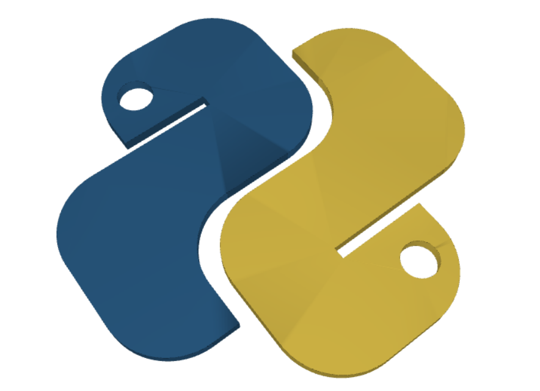
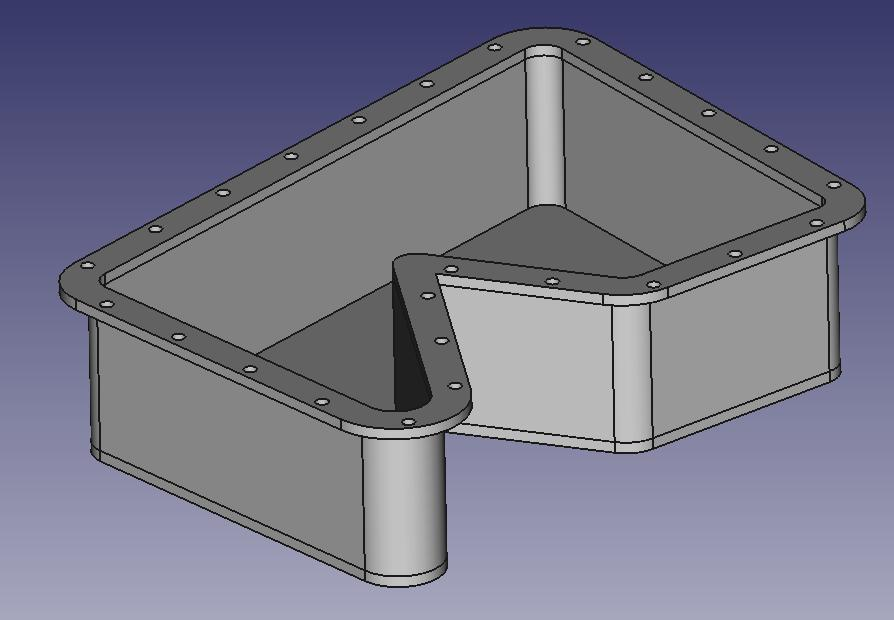
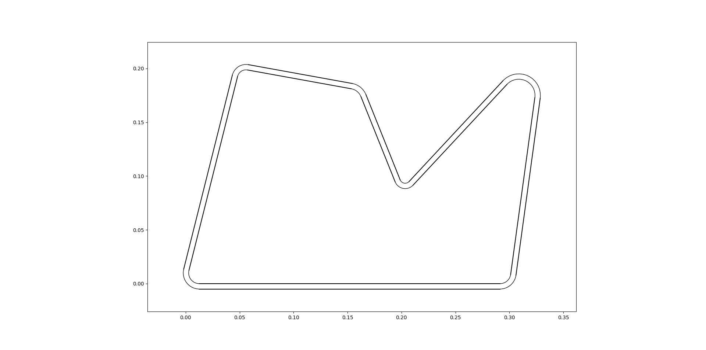
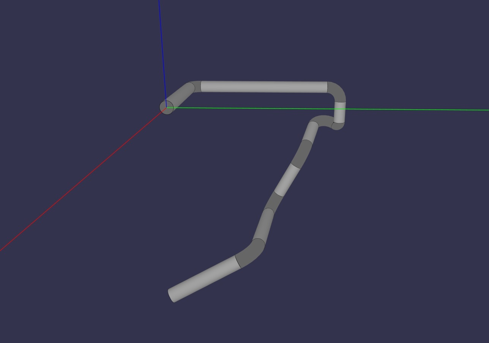
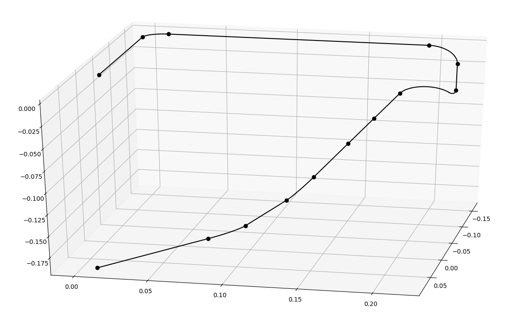
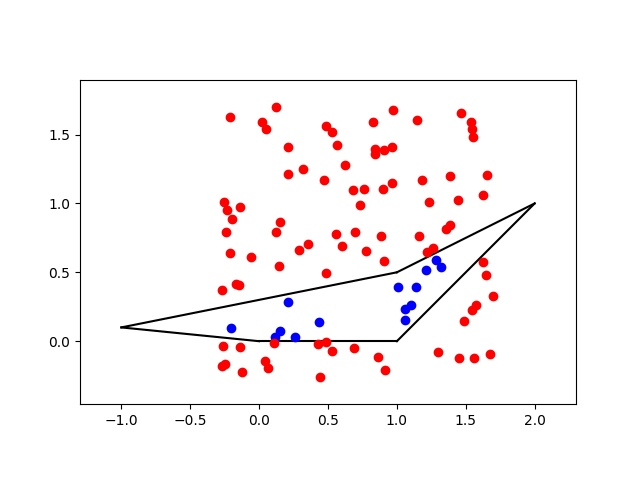
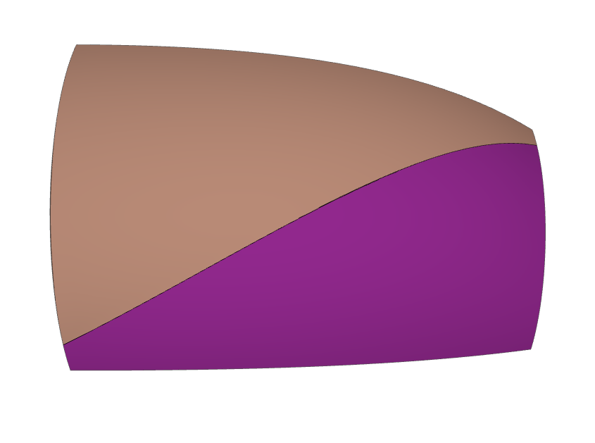

<h1 align="center">
  <br/>design3d
</h1>

<h4 align="center">
  A Python 3D modeler ready for agentic engineering, based on B-Rep, with STEP and STL import and export
</h4>

<div align="center">
  <a href="https://github.com/masfaraud/design3d/actions/workflows/test.yml"></a>
  <a href="https://github.com/masfaraud/design3d/stargazers/"></a>
  <a href="https://pypi.org/project/design3d/"></a>
  <a href="https://github.com/masfaraud/design3d/graphs/contributors"></a>
  <a href="https://github.com/masfaraud/design3d/issues"></a>
</div>

<div align="center">
  <a href="#description"><b>Description</b></a> |
  <a href="#features"><b>Features</b></a> |
  <a href="#user-installation"><b>User Installation</b></a> |
  <a href="#dev-installation"><b>Dev Installation</b></a> |
  <a href="#usage"><b>Usage</b></a> |
  <a href="#license"><b>License</b></a> |
  <a href="#team-and-contributors"><b>Contributors</b></a>
</div>

## Description

design3d is a Python 3D modeler based on Boundary Representation (B-Rep). Its goal is to be a 3D modeler ready for
agentic engineering: AI agents, as well as engineers, can create, analyze and exchange 3D models entirely from code.

To that end, design3d:

- is a plain Python library with no graphical interface to drive: models are built, queried and modified by code, and
  run headless in scripts, notebooks, CI pipelines or agent sandboxes;
- computes what an agent needs to check its own work: distances, intersections, volumes, point belonging, boolean
  operations;
- serializes its objects to JSON (`to_dict` and `SerializableObject.from_json`), so models can be stored, compared and
  passed between tools;
- imports and exports STEP and STL files, to bring the results back into standard CAD software;
- is developed with coding agents in mind: the repository ships instructions for them in [AGENTS.md](AGENTS.md), and a
  test suite to check every change.

Check the examples to see what you can do with this library. design3d is a hard fork of the discontinued volmdlr
project.

<p align="center"> </p>
<i>A casing is defined by a 2D contour formed with the primitive RoundedLineSegment2D. This contour is offset by the casing width.</i><br/><br/><br/>

<p align="center"> </p>
<i>A Sweep is pipes, created with Circle2D/Arc2D which is contained in a Contour2D. You have to create the neutral fiber, i.e., the pipe’s road, with the primitive RoundedLineSegment3D.</i><br/><br/><br/>

<p align="center"></p>
<i>A polygon is defined out of points. Random points are sampled and the tested whether they are inside or outside the polygon. They are plotted with the Matplotlib binding MPLPlot with custom styles:
- red if they are outside,
- blue if they are inside
</i><br/><br/><br/>

<p align="center"></p>
<i>A 3D B-spline surface split by a 3D B-spline curve.</i><br/><br/><br/>

## Features

- [x] Generate 2D and 3D geometries from python
- [x] Handles complex geometries: B-spline curves and surfaces
- [x] Primitives provide computational tasks: distances, belonging, union, intersections, etc.
- [x] STEP/STL imports and exports
- [x] Geometries display in your web browser with [babylon.js](https://www.babylonjs.com/)

## User Installation

```bash
pip install design3d
```

design3d requires Python 3.12 or later.

## Dev Installation

Building design3d compiles Cython extensions, so you need a C/C++ compiler (usually already available on Linux and
macOS; on Windows, install the Microsoft C++ Build Tools).

```bash
git clone https://github.com/masfaraud/design3d.git
cd design3d
pip install -e '.[test,doc]'
pre-commit install
```

See [CONTRIBUTING.md](CONTRIBUTING.md) for how to run the tests and checks before opening a pull request.

## Usage

```python
import design3d
from design3d import primitives3d
from design3d.core import VolumeModel

# A 30 cm cube centered on the origin
block = primitives3d.Block(
    design3d.Frame3D(design3d.O3D, 0.3 * design3d.X3D, 0.3 * design3d.Y3D, 0.3 * design3d.Z3D),
    name="block",
)
print(block.volume())  # 0.027

model = VolumeModel([block])
model.to_step("block.step")  # export to STEP
model.babylonjs()  # display in your web browser
```

More examples are in the [scripts](https://github.com/masfaraud/design3d/tree/master/scripts) folder.

## Documentation

The documentation is not published online yet. To build it locally:

```bash
pip install '.[doc]'
make -C docs html
```

Then open `docs/build/html/index.html`.

## License

100% open source under the LGPL 2.1 license. See [LICENSE](LICENSE) for more details.

## Team and contributors

design3d is a hard fork of the discontinued [volmdlr](https://github.com/Dessia-tech/volmdlr) project: credits to the
volmdlr project team.
